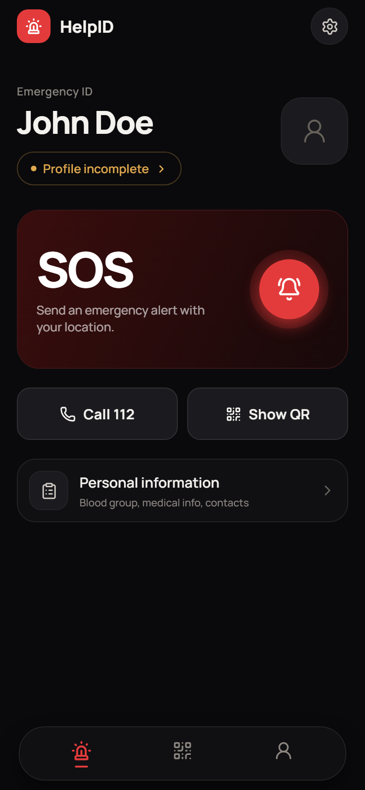
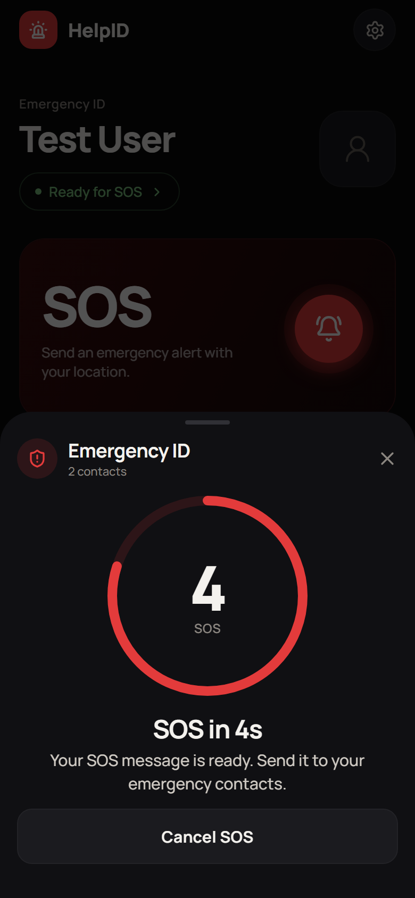
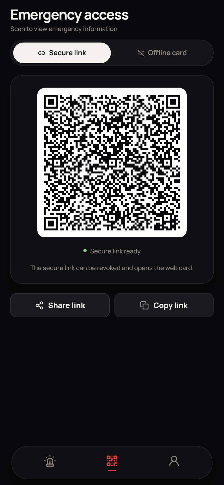
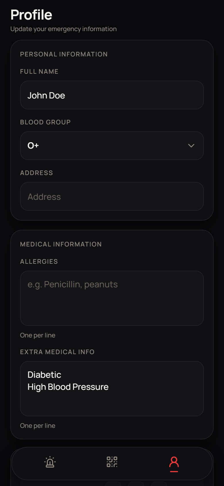
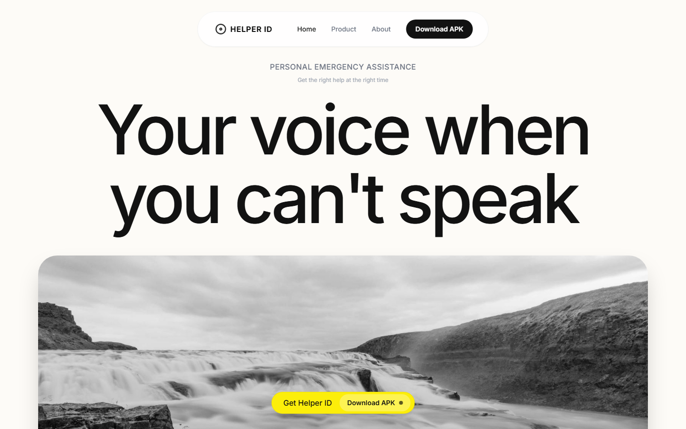
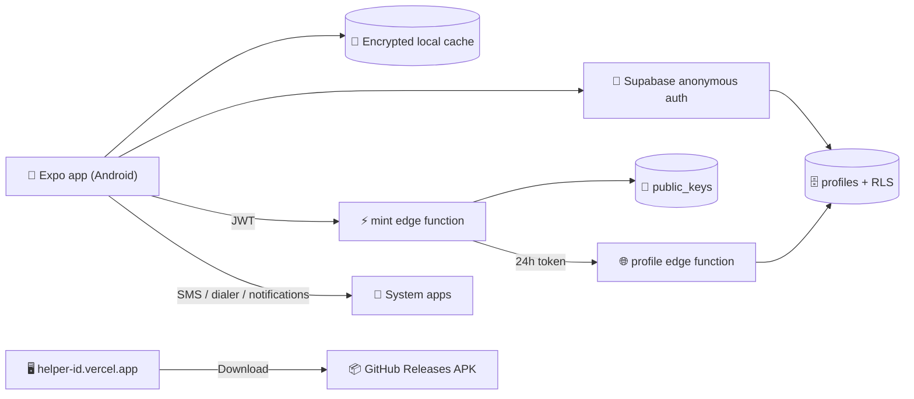
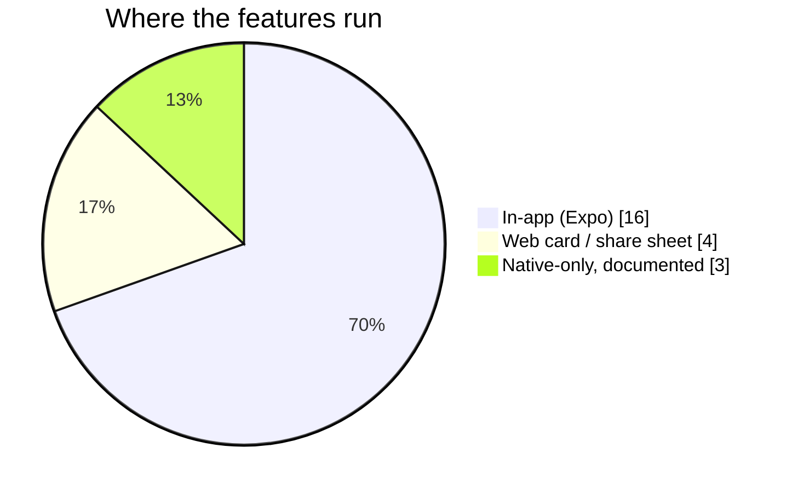

# HelpID

<div align="center">


### Your voice when you can't speak.

An emergency profile, SOS, and QR card app — rebuilt in Expo + Supabase with a dark, minimal interface.

[](https://github.com/akyourowngames/HelpID-Android/releases/latest/download/helpid.apk)
[](https://helper-id.vercel.app)

[](https://github.com/akyourowngames/HelpID-Android/commits/main)
[](https://github.com/akyourowngames/HelpID-Android)
[](LICENSE)
[](https://expo.dev)
[](https://supabase.com)
[](#download)
[](#contributing)

</div>

---

## 📱 Screenshots

<table>
  <tr>
    <td align="center"><br/><sub><b>Home</b> — SOS, call, QR, profile</sub></td>
    <td align="center"><br/><sub><b>SOS</b> — 5s countdown + cancel</sub></td>
    <td align="center"><br/><sub><b>QR card</b> — secure link or offline</sub></td>
    <td align="center"><br/><sub><b>Profile</b> — compact, validated form</sub></td>
  </tr>
</table>

<div align="center">
  
  <br/>
  <sub><b>helper-id.vercel.app</b> — download the APK directly from the site.</sub>
</div>

---

## ✨ Why HelpID

Emergencies create panic. A responder may not know your name, blood group, allergies, or who to call.
HelpID keeps that context ready: a dark, fast home screen with one-tap SOS, a call button, a QR card, and
a compact emergency profile. Everything works offline first, with optional Supabase cloud sync.

## 🚀 Features

| | Feature | Status |
| --- | --- | --- |
| 🚨 | SOS with 5-second cancel countdown and haptics | ✅ In app |
| 📍 | Location link attached to the SOS message | ✅ In app |
| 📞 | Emergency number resolved by country | ✅ In app |
| ☎️ | Auto-call escalation after 30 seconds (opens dialer) | ✅ In app |
| ✉️ | SMS handoff to all emergency contacts | ✅ In app (system composer) |
| 🔁 | Fallback share + copy SOS message | ✅ In app |
| 🔔 | Follow-up reminders every 3 min × 4 | ✅ Local notifications |
| 🩸 | Emergency profile: name, blood group, address, allergies, conditions | ✅ In app |
| 👥 | Contact picker, E.164 validation, call/SMS/copy per contact | ✅ In app |
| 🔐 | Encrypted local cache (AES + SecureStore key) | ✅ In app |
| ☁️ | Anonymous auth + profile sync | ✅ Supabase |
| 🔳 | QR card: signed secure link **or** offline payload | ✅ In app |
| 🌍 | English, Español, हिंदी, Français, Deutsch | ✅ In app |
| 📄 | Share profile text / export PDF | ✅ Settings |
| 🖨️ | Public read-only emergency web card | ✅ Edge function |
| 📲 | NFC beaming | ⚠️ Native-only gap |
| 📵 | Silent SMS / lock-screen intents | ⚠️ Native-only gap |

<details>
<summary><b>Why the native-only gaps?</b></summary>

Expo Go cannot broadcast NFC tags, send SMS without the composer, or show full-screen lock-screen intents.
Those adapters are isolated in `mobile/src/lib/` for a development build. Silent background SMS is also
replaced by local follow-up notifications. Everything else works in Expo Go and in the APK.

</details>

## 🧭 Architecture





## ⚡ Quick start

### Android APK

1. Open the [latest release](https://github.com/akyourowngames/HelpID-Android/releases/latest).
2. Download `helpid.apk` and install it (allow installs from your browser/unknown sources).
3. Or use the direct link: [helpid.apk](https://github.com/akyourowngames/HelpID-Android/releases/latest/download/helpid.apk).

### Expo Go / development

```powershell
cd mobile
npm install
npx expo start
```

Scan the QR with Expo Go. With no `.env`, the app runs fully in local mode.

### Website

```powershell
cd helper-id
npm install
npm run dev
```

## ☁️ Supabase setup

1. Create a Supabase project and enable **Anonymous sign-ins**.
2. Apply `mobile/supabase/migrations/` (profiles, public keys, server-only secret, RLS hardening).
3. Deploy the functions:

   ```bash
   supabase functions deploy mint
   supabase functions deploy profile --no-verify-jwt
   ```

4. Copy `mobile/.env.example` to `mobile/.env` and fill the project URL + publishable key.

The public card URL is signed with a 24-hour HS256 token. Deleting a row from `public_keys` revokes it.
See [`mobile/README.md`](mobile/README.md) for the full walkthrough.

## 🔒 Security notes

- No secrets are committed; `.env` files are ignored and server keys live only in Supabase.
- RLS restricts `profiles` to the owning user; `public_keys` and `app_secrets` are service-role only.
- Public card HTML is escaped and served with `no-store`, `no-referrer`, and `noindex` headers.
- Tampered or mismatched QR tokens return `401`; anonymous users cannot read other profiles.
- Deep security review: **0 findings** at L3, plus manual QR/XSS/RLS checks.

## 🏗️ Repository layout

```text
mobile/                 Expo app (app/, src/, supabase/, EAS-ready)
helper-id/              Vite marketing site + legacy /api routes
docs/screenshots/       README imagery
.github/workflows/      GitHub Actions APK build
```

## 🛠️ Builds & releases

- The APK is built by [`.github/workflows/android.yml`](.github/workflows/android.yml) on pushes to `v*` tags.
- Local native project generation: `cd mobile && npx expo prebuild --platform android`.
- The release workflow produces `helpid.apk`, attached to the GitHub release.

## ⚠️ Medical disclaimer

HelpID supports responders and families. It is **not** a replacement for emergency services. Review medical
data handling carefully before real-world use.

## 🤝 Contributing

Ideas, accessibility fixes, and polish are welcome. Open an issue with a clear problem statement or send a
focused pull request.

## 📄 License

[MIT](LICENSE) © Krish Verma · Helper ID Project
